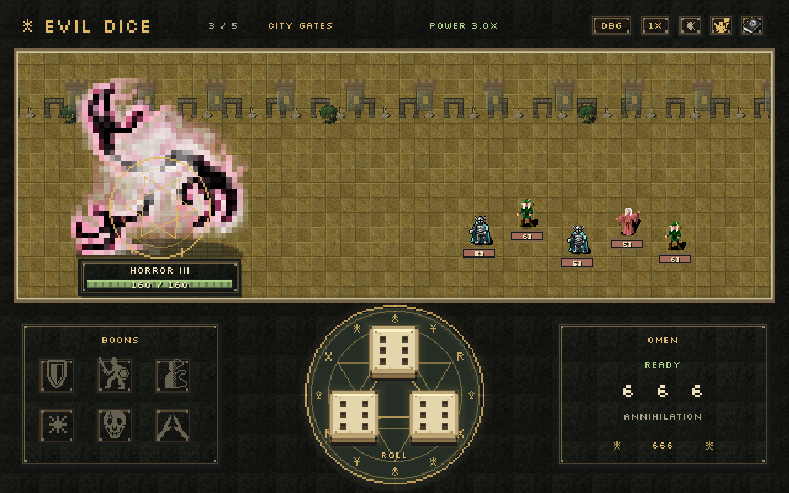
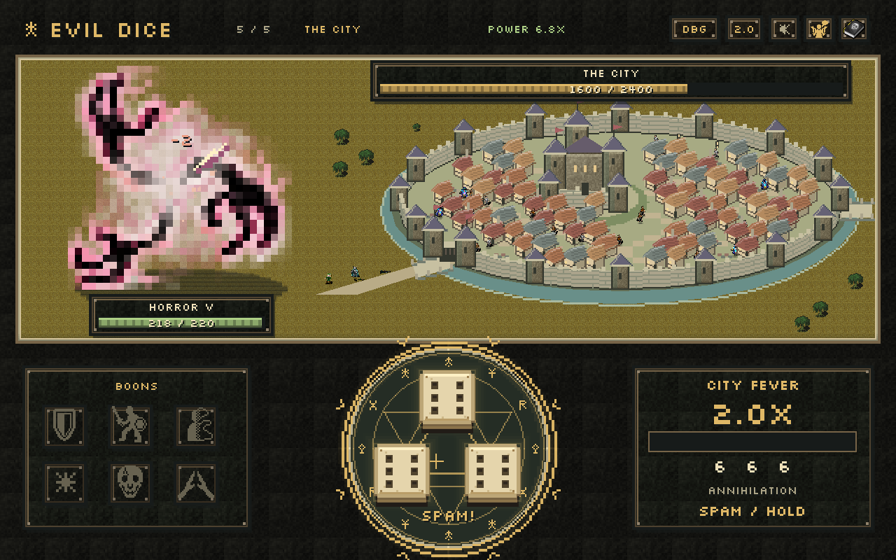
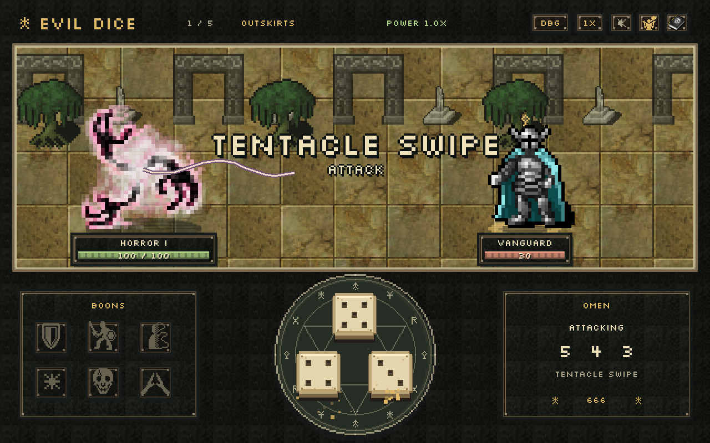

# Evil Dice — mechanics and project description

> The [Chinese Google Design Doc](https://docs.google.com/document/d/1i-PEouZmzwagpz6CTa7CjMVl_UJd99-io_uB7TMgguM/edit) is the primary design and change record. Write future updates there in Mandarin (Simplified Chinese), distinguishing implemented changes from proposals. This file and the earlier English Google Doc remain reference snapshots.

**Prototype 0.8 · Design updated 7 October 2026 · internal design document**

A growing eldritch horror advances through one, three, five, then eight fantasy adventurers before attacking a castle city in real-time fever mode. Roll three D6 once and enjoy the reveal: attacks automatically choose a random living foe and pairs grant automatic buffs. The fifth stage aims all attacks at the city. The tone is playful cosmic horror, with expressive effects and no graphic violence. This version prioritizes roll satisfaction and quick interaction over tactical planning.

This document describes the implemented prototype. New in 0.8: large unframed skill names at the upper third of the screen, a pulsing fever circle and larger frenzy meter, staggered positions for every squad, running troop motion, and civilians and aristocrats fleeing from destroyed houses. Battle three adds ×1.5 damage and cap growth; battle four adds another ×1.5, with the cumulative damage boost carrying into the city. **Annihilation** still clears troops and deals one third of city maximum HP. The strong scenery zoom-out and progressively smaller adventurers from 0.7 remain.

## Confirmed scope

- One eldritch horror, four squad waves, then one city finale; every living squad enemy acts once each round.
- One final three-die result each player turn. No rerolls or held dice.
- Different faces attack; an exact pair buffs; triples 111–555 use specials; 666 destroys the squad.
- Ignore the unmatched die on pair turns. Buffs apply without confirmation.
- Direct attacks receive a 1.5× boost plus fixed growth. The original one-third normal and two-thirds special caps apply to battles one and two; the extra battle-three/four boosts also raise these caps. City attacks have their own formula below.
- Mouse only: click the circular dice tray, use icon controls and restart. Target choice and combat resolution are automatic.
- Fantasy interface with minimal text, pixel lettering and numbers, textured buttons and health bars, triangular bone dice, and a glowing magic-circle hover indicator.
- Lighter battlefield, more detailed public art, strong dice and special-attack feedback.
- Hidden pity guarantees: at least one match within three rolls and at least one triple within six. No pity counter, explanation, progress bar, or probability disclosure in the game UI.

Mutations, growth choices, equipment, additional playable monsters, gacha unlocks, saves, and online features remain future work. Growth is the same every run.

## Run progression and feeding

| Stage | Opponents | Horror max HP | Growth multiplier | Enemy max HP |
| --- | --- | --- | --- | --- |
| Outskirts | One Vanguard | 100 | 1.0× | Vanguard 30 |
| Old Road | Vanguard, Elf Archer, Mage | 130 | 1.5× | Vanguard/Mage 41; Archer 49 |
| City Gates | Vanguard, Archer, Vanguard, Mage, Archer | 160 | 3.0× | Vanguard/Mage 51; Archer 61 |
| Last Company | 3 Vanguards, 3 Archers, 2 Mages, in two staggered rows | 190 | 5.625× | Vanguard/Mage 62; Archer 74 |
| The City | Castle city and continuously arriving troops | 220 | 6.75× | City 2,400 |

After clearing each squad, the Horror gains **30 maximum HP** and heals **55 HP** up to its new maximum. Base power remains `1 + 0.5 × stage_index`. Multiply that by 1 / 1 / 1.5 / 2.25 / 2.25 across the five stages: one extra ×1.5 begins in battle three, another begins in battle four, and both persist into the city. The table shows total growth power before the global ×1.5 direct-attack modifier. The 55 healing fills the new capacity and recovers up to 25 previous damage. Existing shield, unspent buff charges, remaining durations, and pity counters carry forward. No new growth occurs after the final city victory.

Defeated squad members fall and remain on the ground throughout the wave. Their HP plates disappear and they cannot be targeted or healed. At wave clear, leave the bodies visible for 0.65 seconds, then send stylized blood particles toward the Horror while fading bodies over 1.2 seconds. Once feeding finishes, scroll the scenery left and zoom it out over 1.65 seconds. The Horror grows from 224 to 256 to 288 to 320 pixels tall; opposing sprites and scenery become smaller. Different parallax rates for paving, arches, trees, and buildings suggest advancing to a new place. Enemy sprites for the next wave appear on arrival. These durations scale with the ordinary animation-speed control.

Combat stays locked throughout feeding and travel. Apply growth only once; a double click cannot skip or duplicate the transition. The Horror's sprite reaches 320 pixels in stage four and stays that size in stage five. Adventurers shrink much earlier, making the final city encounter a continuation of the established scale. Scenery sizes interpolate smoothly during travel, with paving, trees, arches, and distant buildings receding together. The final arena is a whole circular castle city, with a dominant keep, dense houses, pointed wall towers, a moat, and bridges. Curved walls and buildings progressively become rubble as shared health falls.

| Stage | Horror sprite | Adventurer / troop sprite | Approximate height ratio |
| --- | --- | --- | --- |
| Outskirts | 224 px | 192 px | 1.2× |
| Old Road | 256 px | 96 px | 2.7× |
| City Gates | 288 px | 48 px | 6× |
| Last Company | 320 px | 24 px | 13.3× |
| The City | 320 px | 16 px | 20× |

These are presentation sizes on the logical canvas; they do not change health, damage, or targeting.

## Combat sequence

1. Resolve Regrowth, then choose one random eligible action for each living enemy. Actions and support recipients are locked at round start.
2. Clicking anywhere inside the dice circle starts one roll. Disable repeated combat input during rolling and resolution.
3. Reveal the dice, highlight matching faces, and play combination feedback.
4. A pair applies automatically. An attack samples one uniformly random living foe using gameplay RNG, locks that target, and resolves without another click. Briefly highlight the chosen foe. Squad-wide attacks still hit everyone; only their primary target for flat bonuses is random. Re-reading the locked target cannot consume RNG or change it; dead enemies are excluded.
5. Resolve damage, healing, interruption, and buff consumption. Check the outcome.
6. Each surviving enemy acts once, left to right. Defeated or interrupted foes skip their action. If a support recipient died, cancel the action without retargeting or spending a heal use.
7. Advance effects measured in enemy phases once, then start the next round.

Enemy intentions are internal; the interface only highlights an actor and its action icon during resolution. There is no combat log or pre-roll planning panel.

Clearing a squad advances the run after feeding. Victory requires destroying the city. Defeat occurs when the Horror reaches zero HP. If lethal incoming damage triggers retaliation that also kills the last enemy or city, the mutual defeat counts as a loss. Restart returns to Outskirts and clears growth, HP changes, buffs, effects, bodies, enemy heal uses, debug selections, and pity counters.

## Dice resolution and hidden pity

Classify in this order: **666 → other triple → exact pair → all different**. Dice position never affects the ability. Triples do not also grant pair buffs.

Two internal counters measure consecutive rolls since a match and since a triple. Both begin at zero.

- Normally sample three independent D6 values.
- If five rolls have passed without a triple, make the sixth result a triple. Choose its face uniformly from 1–6, so the ultimate remains possible.
- Otherwise, if two rolls have passed without a match and the sampled result is all different, replace it with an exact pair. Choose the paired face uniformly, the unmatched face uniformly from the other five, and its slot uniformly among the three positions.
- Preserve naturally sampled pairs and triples on a pair-pity roll. A triple takes priority when both guarantees are due.
- An exact pair resets the match counter and advances the triple counter. Any triple resets both. A normal advances both.
- Invalid or repeated roll attempts do not advance counters. Animations use a separate RNG. Developer-forced results use the same bookkeeping.

This is a drought-based guarantee, not fixed bonuses at absolute turns 3 and 6. Every sliding window of three rolls contains a pair or better, and every window of six contains a triple. A triple satisfies the match guarantee because it is the stronger combination. This avoids forcing a buff in place of a special.

The triple interval was shortened from ten rolls to six to make special attacks appear more often. An early natural triple restarts the six-roll countdown. The guaranteed triple can still be 666; it does not guarantee an ultimate specifically. Late-stage damage and cap boosts are independent of pity.

For classifier verification only, the 216 unweighted outcomes partition into 120 normals, 90 pairs, five regular triples, and one ultimate. **These are not the live outcome rates:** pity makes rolls history-dependent. Do not present real-dice odds as this game's probabilities.

## Damage and resources

The Horror starts at **100 HP** and zero shield. Enemy base HP is Vanguard **30**, Elf Archer **36**, Mage **30**; multiply by `1 + 0.35 × stage_index` and round to the nearest integer for squad stages. Every unit's shield is capped at 20 and persists until depleted. Healing stops at the current maximum HP.

Direct attacks resolve in this order:

1. Normal base damage is the sum of three distinct faces (6–15); specials use the base values below.
2. Add Hungry Tentacles (+6) and Dread Majesty (+3) to the primary target only.
3. Multiply the resulting damage by **1.5 × growth_multiplier**, then round down.
4. Apply each target's cap: `floor(max_hp × stage_boost / 3)` for normals, `floor(max_hp × 2 × stage_boost / 3)` for specials. `stage_boost` is 1 / 1 / 1.5 / 2.25 for the four squad battles.
5. Absorb damage with shield unless the ability ignores it. Apply remaining HP loss, clamped to current HP.

At base health the Vanguard/Mage caps are 10 and 20; Archer caps are 12 and 24. Caps grow with target maximum HP and the explicit stage boost, never with temporary attack buffs. City Gates normal/special caps are 25/51 for the 51-HP Vanguard/Mage and 30/61 for the 61-HP Archer. Last Company caps are 46/93 for 62 HP and 55/111 for 74 HP. Thus battle-three specials can kill an unshielded full-health foe, and battle-four specials can overcome a full-health foe and its shield. The 444 area special can clear later squads. Actual HP loss never exceeds remaining health. Every ability has one damage event per target; visual multi-hits never multiply gameplay damage.

The ultimate directly removes all remaining enemy HP and ignores shield. The 1.5× modifier applies to direct attacks only; healing, shield gains, enemy damage, and Spines' fixed 6 retaliation are unchanged.

At base power and base enemy health: 1/2/3 deals 9 before shields instead of 6; 1/2/4 deals 10 after rounding; 4/5/6 deals at most 10 to a Vanguard; Brain Freeze's 18 base becomes 27 before the cap, at most 24 against a base-health Archer. In battle three, 1/2/3 against the Archer rises from the previous 18 to 27, while a high normal against the Vanguard rises from 17 to its new 25 cap.

## Pair buffs

Pairs are pure buff turns. Their unmatched die has no effect. Different buffs coexist; reapplying refreshes duration/charges without stacking strength. Effects apply automatically after the reveal.

| Pair | Buff | Exact effect | Flavor / feedback |
| --- | --- | --- | --- |
| 11 | Barnacle Armor | Gain 10 shield, up to 20. Persists until broken. | Ancient barnacles report for bodyguard duty; a moss-green barrier ring forms. |
| 22 | Hungry Tentacles | One charge: add 6 base damage to the next attack's primary target, before 1.5×, growth, and the cap. | The tentacles have mistaken the squad for room service. |
| 33 | Unnatural Regrowth | Heal 4 at each of the next three round starts. Refreshing restores three future ticks; no immediate tick. | A replacement tentacle arrives without the warranty paperwork. |
| 44 | Spiteful Spines | For two full enemy phases, retaliate for 6 against the first enemy that removes HP or shield, once per phase. Includes the phase immediately after application. | A sea urchin's attitude, scaled to an ancient god. |
| 55 | Feast on Fear | One charge: after the next attack, heal half the total actual enemy HP removed, rounded up, maximum 10. | The Horror slurps the panic like an overpriced soup. |
| 66 | Dread Majesty | Two charges: attacks ignore all enemy shields and add 3 base damage to the primary target, before 1.5×, growth, and the cap. | The universe recognizes management. Adventurers do not. |

Attack charges persist through subsequent buff turns. Each direct attack spends one charge of every active attack buff, including fully shielded attacks; squad attacks consume only one charge. Overkill does not inflate Feast healing. Dread Majesty does not increase ultimate chance or directly trigger it.

Spines respects enemy shields, receives no direct-attack bonuses, and triggers no lifesteal. It can resolve after lethal incoming damage. Its duration advances once after the full enemy phase, never once per enemy.

## Triple specials

Values in the damage column show **base → damage at 1.0× growth before the cap**. Multiply further by the current total growth multiplier before rounding and capping. The special cap is two thirds of target maximum HP in battles one/two, full maximum HP in battle three, and 1.5 times maximum HP in battle four, before shields and clamping actual HP loss. City values are listed separately below.

| Triple | Ability | Damage and effect | Flavor / feedback |
| --- | --- | --- | --- |
| 111 | Tentacle Tantrum | 24 → 36 to one enemy. | Several tentacles lodge the same complaint simultaneously. Sweeping strands, impact burst, one damage number. |
| 222 | Brain Freeze | 18 → 27 to one enemy; if it survives, cancel its locked action this round. | A psychic error leaves the enemy buffering. Violet rings and a dazed indicator. |
| 333 | Deep Sea Snack | 20 → 30 to one enemy; heal the Horror for 8, even if shield absorbs all damage. | An appetizer of courage. Tentacle sweep and healing pulse. |
| 444 | Ink from Beyond | 20 → 30 to every living enemy; cap each target separately. | An ink spill large enough to require a committee. Purple splash across the squad. |
| 555 | Reality Hiccup | 22 → 33 to one enemy, ignoring shield. | Reality briefly forgets which side of cover is safe. Portal rings and impact pixels. |
| 666 | Annihilation | Destroy the current squad regardless of HP or shield. In city mode deal 800 damage and clear troops. Heal 12 in either mode. | An abyssal portal turns up without planning permission. Gold dice reveal and pale tentacles; the skill announcement has no subtitle. |

Brain Freeze only cancels the current action. No lasting stun. The primary target receives flat attack bonuses on squad attacks; Dread Majesty's shield bypass applies to every hit. Ignoring shield leaves the shield value unchanged. Feast healing and a special's own healing can both resolve, each capped by maximum HP.

## Enemy squad

Every living enemy randomly selects one eligible action at round start. Relative weights are normalized among eligible choices. There are no enemy dice rolls.

| Enemy | Attack | Support |
| --- | --- | --- |
| Vanguard, 30 HP | Sword Slash: 3 damage, weight 65 | Raise Shield: +6 own shield, weight 35; eligible below shield cap |
| Elf Archer, 36 HP | Arrow Shot: 4 damage, weight 70 | Covering Fire: +4 shield, weight 30; choose the living eligible enemy with lowest current HP, ties leftmost |
| Mage, 30 HP | Arcane Bolt: 2 damage, weight 60 | Mend: heal 6, weight 40; choose the living enemy missing most HP, ties leftmost; maximum two successful heals |

An attack is always eligible. Support actions require a valid recipient. A support action locked earlier may restore less than its nominal amount; do not select a new recipient. The Mage spends a use only when at least one HP is restored. Listed HP values are bases, scaled by stage. All-attacking squads deal 3, 9, and 16 damage before shield in stages one through three. At stage four the enormous Horror takes reduced individual damage: Vanguard 1, Archer 2, Mage 1, totaling 11 if all eight attack. Every living adventurer still acts, with unchanged support strengths. Duplicated classes retain their own action and heal-use state.

## City fever

The fifth and final encounter is real time. The large city health bar starts at **2,400 HP**. Troops and volleys keep attacking during dice rolls and player casts; there is no enemy-turn wait. Normal and special attacks aim at the city automatically. Troops march out of the gate; ranged attacks originate at a wall tower.

- Rolling and action delays start at **2×** normal speed. Clicking the circle adds 0.28 frenzy, up to 1. Frenzy decays by 0.32 per second. The resulting speed is `2 + 0.5 × frenzy`, capped at **2.5× total**, not 5×.
- Holding the left mouse button inside the circle builds frenzy at 1.1 per second before decay and starts the next roll when ready. This supplies a mouse-only alternative to repeated clicking.
- Clicks during an existing roll change frenzy only. They cannot sample dice again, alter the accepted result, or apply duplicate damage. Releasing the mouse or losing window focus stops hold input.
- Two troops arrive every **2.5 seconds**, up to six. Every **1.5 seconds**, each living troop contributes **1 damage**. A ranged volley deals **7 damage every 4 seconds**, with a warning during its final 0.8 seconds. Both sources use the Horror's shield first.
- Opening the debug picker or grimoire pauses city attacks, troop movement, and fleeing inhabitants. The existing speed toggle does not override fever speed. There is no keyboard input.
- A gold ring pulses at 1.8 cycles per second around the dice with inward arrows and a **SPAM!** label, including during rolls and resolution. The omen panel becomes CITY FEVER with a 44-pixel multiplier, a 294×26-pixel segmented meter, and **SPAM / HOLD**. Reduced effects keeps a steady indicator instead of pulsing.

Normal and 111–555 city damage is `floor((base + attack_bonuses) × 1.5 × growth_multiplier × 2)`, clamped only to remaining HP, without squad caps. At 6.75× total growth this is 20.25× base: unbuffed normals deal 121–303. **666 is a separate fixed 800 damage**, exactly one third of maximum city HP; growth and attack buffs cannot increase it. Clamp overkill to remaining HP. Thus one 666 leaves a full city at 1,600 HP, two leave 800, and three finish it. Every special clears currently active troops, leaving small bodies; reinforcements continue unless stunned. Keep at most 24 troop bodies.

| Triple | Unbuffed city damage | Additional effect |
| --- | --- | --- |
| 111 | 486 | Clear troops |
| 222 | 364 | Clear troops; freeze attack and reinforcement timers for 3 seconds |
| 333 | 405 | Clear troops; heal 8 |
| 444 | 405 | Clear troops |
| 555 | 445 | Clear troops; the city has no shields to bypass |
| 666 | 800 | Clear troops, heal 12; win only if this removes the remaining city HP |

Pairs still apply automatically and deal no damage. Armor persists until broken. Hungry Tentacles, Feast, and Dread retain attack charges. Regrowth heals at the start of each of the next three **accepted rolls**, not on a wall-clock timer. Spines lasts two intervals between completed rolls, starting on application; it reflects 6 city damage on the first incoming attack per interval. Completing another pair also advances that duration. Its reflection is not multiplied. Dread's +3 base remains useful even though the city has no shield. Reapplying a boon refreshes it, without stacking its strength.

City time uses bounded 0.05-second simulation steps and processes at most 0.25 seconds from a frame. A window stall therefore cannot inflict an unlimited backlog of invisible damage. Combat stops immediately on defeat or victory; the killing player spell finishes its reveal before the ending panel appears.

City troops use small alternating leans and hops as they run along the approach road. Each house crossing its ruin threshold releases one or two inhabitants at that house, using the same destruction predicate as the renderer. The crowd mixes plain-clothed civilians with blue-and-gold aristocrats. They choose erratic short destinations, avoid intact house footprints and the keep, remain inside the walls, and briefly display pixel panic marks. Draw them among houses by depth and behind the front walls. Residents are cosmetic: they cannot attack, take damage, or alter combat RNG. Track each ruined house once to prevent repeated spawning, cap the crowd at 96, fade individuals after 12–20 seconds, and clear all crowd state on restart. Reduced effects removes their lean/hop while preserving movement.

## Visual debug controls

Click **DBG** in the top bar to open the dice picker. It contains Natural Random, Random Singles, six illustrated double cards, and six illustrated triple cards. Choose a card, then roll with the usual circle. Singles sample three distinct faces; doubles randomize the unmatched face and position; triples specify all three faces. **Repeat: Off** consumes the selection once; enable Repeat to keep forcing it. Natural Random restores ordinary rolls. Forced outcomes bypass pity enforcement but still update its counters. This menu is explicitly a development control and never exposes pity counters or rates.

## Interface and visual direction

### Characters and art consistency

| Character | Current appearance | Combat identity |
| --- | --- | --- |
| The Horror | Pale, tangled tentacles with dark outlines and pink/violet shading; the public Worldbinder sprite | Player-controlled eldritch creature; tentacle attacks, automatic boons, and abyssal spells |
| Vanguard | Heavy silver armor and a dark teal cloak | Sword Slash and Raise Shield |
| Elf Archer | Green clothing, pointed ears, pale hair, and a bow | Arrow Shot and Covering Fire |
| Mage | Flowing rose-colored robes, pale hair, and a casting pose | Arcane Bolt and Mend |

All character types come from the same Dungeon Crawl Stone Soup public tile collection and use 32×32 source sprites. Squad sprites shrink from 192 to 96 to 48 to 24 pixels; city troops and inhabitants are 16 pixels. Every squad with multiple enemies uses different horizontal and vertical positions, with HP bars following their owners. Later formations pack more closely together, with compact HP bars for the five- and eight-member squads. The fourth-stage party uses two rows of four. Corpse placement, spell targets, feeding origins, and idle motion follow each adventurer's position and scale. These are static source sprites animated through positioning, tint, death rotation, and effects. A specific Cthulhu likeness is not required.

Continue using public assets with compatible pixel density, outlines, shading, and perspective. Use nearest-neighbor texture sampling; the zoom transition intentionally changes apparent pixel size. Keep the humor in ability names, reactions, and end-screen jokes, with non-graphic impacts and stylized feeding particles. No custom AI art is used in this version.

### Battlefield and interface materials

1280×800 logical canvas. A light limestone courtyard fills the top half at the start, with ruined arches, columns, trees, and an approaching city skyline. The ground gradually blends into grass across stages three and four as the view pulls back. Paving tiles shrink from 96 to 48 to 24 to 16 pixels; scenery props shrink from 128 to 64 to 32 to 16, then 12 pixels. The Horror stands left and the current squad or city stands right. The lower area holds boons on the left, the dice circle in the center, and the omen panel on the right.

*Prototype 0.8: the third battle uses a staggered group of five. The fourth retains eight adventurers in two displaced rows.*

*Prototype 0.8: fifth-stage city fever after an attack. The settlement is circular in plan and oval in the preserved oblique perspective. The user's reference informs composition; the game uses existing public textures and code-drawn geometry.*

The interface uses textured stone, bronze edges, and a moss, parchment, and violet palette. Buttons have pixel borders, highlights, and visible hover states. Silkscreen supplies every label, number, tooltip, floating damage value, and guide entry, with font smoothing and subpixel placement disabled. Health bars use shaded pixel segments and numeric HP; shield badges appear only when active.

Keep persistent text brief: character names and HP, stage, growth power, boon counters, current action, and the latest dice result/ability. City mode adds a frenzy bar and speed multiplier. Explanations belong in tooltips and the dice grimoire. No combat log, enemy planning panel, or pity indicator appears during play.

### Mouse interaction

| Area or state | Interaction and feedback |
| --- | --- |
| Ready dice circle | Three carved bone dice sit in a triangle. Click anywhere inside the circular boundary, including the gaps between dice. Hover illuminates the seal and adds a small cursor sparkle. |
| Magic-circle ornament | Interlaced triangles, twelve pixel runes, and concentric seals surround the dice. The glow is visual feedback; it does not change the roll. |
| Rolling or resolving | Extra clicks cannot reroll or apply an action twice. In city mode they increase frenzy. |
| Attack result | Automatically highlight a random living primary target and cast. No target click or hover preview. Squad-wide attacks still hit everyone. |
| Pair result | Show the matching pair, apply its boon automatically, and continue to the enemy phase. No confirmation click. |
| Boons | Six icons show active effects. Armor displays current shield; the others display charges or remaining duration. Hover for the name and effect. |
| Omen | Display a brief state such as Ready, Pair, Triple, Casting, or Enemy Turn, plus the latest roll and ability name. |
| Top controls | Click DBG for the visual roll picker, 1×/2× for ordinary animation speed, sound, reduced effects, or the book-shaped grimoire. Both menus block combat input and pause city timers. |
| Wave end | Automatic feeding, corpse fade, growth, and travel. No continue click needed. |
| Run end | A short victory/defeat message and textured Restart button begin a fresh run. |

There are no keyboard bindings, reroll controls, separate roll button, or buff-claim button. Clicking outside the circle, including the corners of its bounding square, does not roll.

### Dice and attack feedback

Give the most visual and audio emphasis to rolling, matching combinations, and special attacks. Every roll tumbles and lands in sequence, with impact sounds and small pixel bursts. Matching dice pulse and connect across the circle.

| Result | Reveal and resolution |
| --- | --- |
| All different | Announce Tentacle Swipe / attack, then automatically swipe a random foe. Small screen shake on impact. |
| Exact pair | Moss-green dice glow, sparks, original confirmation sound, and a large PAIR burst centered on the dice. Announce the boon and apply it automatically. |
| Triple 111–555 | Violet dice glow, a large TRIPLE burst, expanding ring, original deep reveal sound and rising four-note chime. Announce and automatically cast the spell; large shake on impact. |
| Triple 666 | Gold dice glow, large 666 burst, deeper reveal and chime. Announce Annihilation with no subtitle. The portal attacks the squad or damages the city; large shake on impact. |

Combo text starts at the triangle's center (639, 640), rapidly enlarges over 0.12 seconds, settles from its overshoot, then fades while moving 84 pixels upward. Total life is 1.05 seconds. Render it above the dice, with a thick dark outline and brief radial streaks. Skill names float without a window at the upper third of the screen: centered at x=640 with a baseline near y=280, settling from 58 to 52 pixels, with a dark outline. They remain for 1.4 seconds with a 24-pixel concise effect line beneath. Boon captions are shield+, attack+, regen, reflect, lifesteal, and attack+, pierce. Specials describe their actual effect, such as attack all or attack, freezes; city captions reflect troop clearing. Annihilation always omits that line.

Normal attack impact starts a 3-pixel shake; any triple starts a 12-pixel shake, decaying at 24 pixels per second. The entire rendered canvas shakes together, including spells and dice. Reduced effects disables shake; restarting restores the camera immediately.

Enemy actions have distinct sword, arrow, or arcane-bolt effects. Damage adds bright diagonal slash streaks and impact particles. Boons, spells, combo reveals, enemy support, and feeding activate rotating rune circles. Player spells and enemy projectiles use separate effect state so simultaneous city attacks cannot erase a special. Visual multi-hits do not add extra damage events. Reduced effects remove flashes, screen shake, character bobbing, and sigil rotation; dice and result feedback remain available.

Dice audio restores the earlier CC0 Kenney Interface Sounds: click_001 while tumbling, drop_001 on landings, confirmation_002 for pairs, bong_001 for triples, and the four-note pluck_001 reveal chime. Weapon slashes, punch/glass impacts, spell resonance, boons, feeding, and book sounds retain Kenney Impact Sounds/RPG Audio. A dedicated Combat bus has a limiter, and playback is bounded to twelve voices. Sound can be muted from the top bar.

### Public assets

Public assets and original license notices are documented in [asset credits](../assets/CREDITS.md). Active character, scenery, and skill-icon textures use the CC0 Dungeon Crawl Stone Soup collection; selected filenames are recorded in `assets/art/fantasy/sources.json`. Kenney supplies sound; Silkscreen supplies typography. Earlier prototype artwork remains on disk for reference and is no longer loaded by the game.

## Implementation and validation

Keep squad gameplay in `battle_rules.gd`, with `run_rules.gd` extending it for growth, stage caps, automatic target selection, wave composition, and city simulation. Presentation lives in `battle.gd`, `die.gd`, `effects.gd`, `pixel_paint.gd`, and `city_paint.gd`; `city_life.gd` manages the cosmetic crowd and its destruction ledger. Model phases reject duplicate or out-of-order inputs. Cosmetic randomness must not consume gameplay RNG state. Scene coroutines use a run identifier so restart cancels stale rolls and transitions.

Automated checks cover all 216 classifications, permutation invariance, boosted/rounded damage, stage-dependent caps, shields, every buff and special, action cancellation, all living foes acting, duplicate input, restart, and pity precedence/reset behavior. Seeded rolling checks verify no match drought exceeds two rolls and no triple drought exceeds five, with the fifth roll still natural and the sixth guaranteed after five misses. Scene smoke tests exercise automatic buffs, circle geometry and click flow, target resolution, guide modality, and keyboard exclusion.

The original isolated three-enemy regression remains **200 wins and 13.9 mean rounds** across 200 fixed seeds. The five-stage sample uses 100 fixed seeds, automatic random targets, and 1.5 seconds per city roll: **97 wins, 58.0 mean rolls**. Defeats by stage are 0 / 0 / 2 / 1 / 0. The previous damage settings produced 44 wins; raising both power and caps makes the later run substantially easier. These are reproducible automated baselines, not human playtest results or promises about real win rates. Player hesitation and frenzy timing affect city survival.

Validation includes 33,331 original combat checks plus 435 run checks covering progression, carryover, raised caps, five/eight-enemy actions, automatic target locking and dead-target exclusion, city clocks, fixed 800-point ultimates, and restart. Another 224 city-life checks cover spawn origins, no duplicate releases, both inhabitant types, movement within the walls, expiry, capacity, restart, and combat RNG isolation. Scene tests cover all boons/specials, combo/skill announcements, normal/triple/reduced-effect shake, debug, persistent bodies, feeding, all five stages, city automation, crowd/modal pause, frenzy limits, and coroutine cancellation. Rendered snapshots review large unframed skills, staggered formations, the castle city, fleeing inhabitants, fever feedback, partial destruction, and the ultimate.
